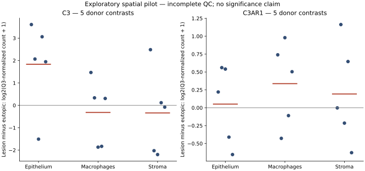

# Pilote spatial : compartiments des lésions d’endométriose

## Résultat et statut

**Un atlas descriptif calculé sur les comptes publics, pas une découverte thérapeutique.** GSE263897 contient cinq donneuses, dix tissus appariés et 60 segments spatiaux GeoMx : stroma, épithélium et macrophages, chacun avec deux segments par tissu/donneuse. Ce ne sont pas 60 personnes ni des cellules isolées. Les donneuses étaient en phase sécrétoire et les lésions péritonéales superficielles. La cohorte ne démontre rien pour toutes les formes d’endométriose.

Le pipeline a importé 18 676 cibles endogènes et 139 sondes négatives. L’atlas comporte donc **56 028 lignes cible × compartiment**, avec les cinq différences individuelles, deux normalisations et les indicateurs de détection. Les symboles sont ceux du PKC original, sans remappage HGNC ; ne pas joindre automatiquement cet atlas à la table bulk par symbole sans audit des alias.

**Contrôle de qualité incomplet : aucune inférence confirmatoire autorisée.** Les exports publics examinés ne donnent pas la surface des segments, le nombre de noyaux, la saturation/dédoublonnage, les NTC, une évaluation de pureté histologique ou la liste complète des exclusions des auteurs. Les fractions de cibles dépassant la limite descriptive de quantification varient de 3,48 % à 32,92 %. Dans certains segments, Q3 = 1 : les différences normalisées peuvent dépendre fortement du plancher technique. Le contrôle de qualité n’est pas validé par les seules bonnes fractions d’alignement.

## Axe C3 : illustration d’une hypothèse déjà publiée

Les auteurs ont déjà proposé un rôle de C3 et de la communication épithélium–macrophages (iScience 2025, DOI 10.1016/j.isci.2025.111790). C3 et C3AR1 ont été choisis avant calcul des effets de ce pilote sur la base de cette publication, pas à partir d’un classement de nos résultats. **Ce projet ne revendique ni l’originalité de cet axe ni sa validation.**

| Cible | Compartiment | Différence moyenne Q3 | Sensibilité médiane | Donneuses avec hausse Q3 | Segments ≥ LOQ |
|---|---|---:|---:|---:|---:|
| C3AR1 | Epithelium | 0.051 | 0.129 | 3/5 | 1/20 |
| C3 | Epithelium | 1.835 | 1.948 | 4/5 | 19/20 |
| C3AR1 | Macrophages | 0.337 | 0.413 | 3/5 | 10/20 |
| C3 | Macrophages | -0.317 | -0.236 | 3/5 | 19/20 |
| C3AR1 | Stroma | 0.193 | 0.281 | 2/5 | 0/20 |
| C3 | Stroma | -0.339 | -0.251 | 2/5 | 14/20 |

Les différences sont sur l’échelle log2(compte normalisé + 1), pas des log2 fold changes absolus du nombre de molécules. Le faible signal C3AR1 dans le stroma et l’épithélium rend ses petites différences particulièrement fragiles. Même dans le compartiment macrophagique, 10 segments sur 20 seulement dépassent la LOQ. Une hausse descriptive de C3 épithélial chez quatre donneuses ne prouve pas une activation du complément.



## Ce qui est mesuré et ce qui reste à tester

| Proposition | Niveau de preuve dans ce pilote | Test décisif à réaliser |
|---|---|---|
| ARN C3 différent entre segments épithéliaux des deux tissus | Descriptif ; QC incomplet | Reproduction dans une cohorte indépendante avec QC complet et analyse au niveau donneuse |
| C3 produit et sécrété par l’épithélium lésionnel | Non mesuré | Mesurer protéine et sécrétion avec localisation cellulaire |
| C3 clivé en complément actif, dont C3a | Non mesuré | Mesurer fragments d’activation et distinguer expression de l’activation |
| Signal transmis aux macrophages via C3AR1 | Non démontré par co-expression | Perturber séparément C3 et C3AR1 dans un modèle adapté ; contrôler les autres sources de complément |
| Signal nécessaire à la persistance lésionnelle | Non mesuré | Tester causalement survie, invasion et inflammation avec témoins et expérience de restauration |
| Une inhibition améliore la maladie sans dommage | Non mesuré | Évaluer bénéfice, spécificité et effets sur fonctions physiologiques avant traduction clinique |

Ces étapes définissent une expérience falsifiable, pas une recommandation de traitement. Pas de classement de médicaments, pas de conseil d’auto-expérimentation. Une voie immunitaire impliquée dans un modèle n’est pas automatiquement une cible sûre ou efficace chez une patiente.

## Méthode reproductible

1. Importer les fichiers officiels SOFT/DCC/PKC, vérifier noms de fichiers et accessions, puis vérifier chaque groupe de deux segments.
2. Les DCC sont creux : remplir à zéro les sondes PKC absentes, conformément au code officiel de lecture GeoMx (`fill=0`). Rejeter tout identifiant inconnu. Le PKC contient exactement une sonde par cible endogène : aucune moyenne de plusieurs sondes biologiques n’est nécessaire ici.
3. LOQ descriptive = max(2, moyenne géométrique des négatifs × écart-type géométrique des négatifs²), négatifs bornés à 1 pour le calcul logarithmique. La détection est calculée sur les comptes zéro-remplis non bornés. Cette approximation explicite n’est pas une reproduction certifiée du workflow R des auteurs.
4. Normalisation exploratoire Q3 sur toutes les cibles endogènes, puis log2(compte normalisé + 1). Les comptes sont bornés à 1 avant calcul des facteurs et normalisation. Facteur = quantile du segment / moyenne géométrique des quantiles. Sensibilité : remplacer Q3 par médiane. Ce plancher et l’absence de sélection/exclusion complète des segments limitent l’interprétation.
5. Moyenner les deux segments sur l’échelle logarithmique par donneuse, tissu et compartiment, puis calculer lésion − eutopique. Une donneuse reste une unité statistique, quels que soient le nombre de segments ou de cellules.
6. Exporter toutes les cibles, sans filtrage selon l’effet observé, sans p-value ni test de significativité. Avec cinq donneuses, la plus petite p-value bilatérale exacte de retournement des signes est 2/32 = 0,0625, sous l’hypothèse de symétrie des différences : elle ne permet déjà pas un seuil non corrigé de 5 %.

Le plan a été écrit après inspection des formats et du résumé de la cohorte, avant calcul des effets. Un amendement avant calcul documente le format creux et le plancher à 1. Ce n’est pas un préenregistrement externe. Le code Python ne remplace pas GeoMxTools et ne reproduit pas les résultats finaux des auteurs.

```bash
python endometriosis/research/spatial_pilot.py --cache endo_raw --out endometriosis/results
python endometriosis/research/report_spatial_pilot.py
python -m unittest discover -s endometriosis/tests -p 'test_*.py'
```

## Fichiers

- [Atlas complet des compartiments](spatial_compartment_atlas.csv.gz)
- [Audit des 60 segments](spatial_segment_audit.csv)
- [Résumé, hashes et sources](spatial_pilot_summary.json)
- [Code d’import et analyse](../research/spatial_pilot.py)
- [Plan d’analyse](../research/SPATIAL_PILOT_PLAN.md)
- [Figure PNG](spatial_pilot_figure.png)

Les sources publiques originales se téléchargent à la demande et ne sont pas redistribuées dans ce dépôt. Hashes du code et du plan ayant produit l’atlas dans le résumé JSON. Python/numpy/pandas pour l’analyse, matplotlib pour les figures.

## Sources primaires

- GEO : https://www.ncbi.nlm.nih.gov/geo/query/acc.cgi?acc=GSE263897
- Publication : https://doi.org/10.1016/j.isci.2025.111790
- Spécifications GeoMx : https://github.com/Nanostring-Biostats/GeomxTools/blob/master/specs.md
- Lecture creuse DCC/PKC : https://github.com/Nanostring-Biostats/GeomxTools/blob/master/R/readNanoStringGeoMxSet.R
- Workflow officiel : https://www.bioconductor.org/packages/release/workflows/vignettes/GeoMxWorkflows/inst/doc/GeomxTools_RNA-NGS_Analysis.html

## Suite fondée sur les limites observées

Obtenir les annotations QC complètes et reproduire les exclusions/normalisations officielles avant tout test. Répliquer ensuite à l’échelle donneuse dans une cohorte spatialement ou cellulairement résolue indépendante, en contrôlant phase du cycle, hormonothérapie, site anatomique et compartiment. Ne pas présenter une comparaison bulk comme réplication d’un mécanisme épithélial. GSE247695 (quatre paires single-cell) et GSE266265 (grand atlas eutopique ; objet RDS public de 39 Go) ont été audités au niveau métadonnées, **pas analysés** dans ce pilote : aucune réplication n’est annoncée. Le second contraste porte sur endomètre eutopique malade/contrôle et ne valide pas directement un mécanisme de lésion.
